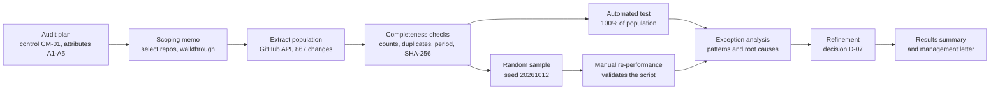

# ITGC Change-Management Audit Testing on Real GitHub Data

Independent IT general controls (ITGC) test of the **change-management control** across **867 real code changes** in two widely used open-source security tools — performed the way an IT audit team tests a client's change process: plan, scope, extract and validate the population, sample, test 100% with automation, investigate exceptions, and report.

**Frameworks:** SOC 2 CC8.1 · ISO/IEC 27001:2022 A.8.32 (change management) and A.5.3 (segregation of duties)

> Independent portfolio project using public data only. The projects reviewed are not bound by the illustrative control tested; results are not findings of non-compliance.

## Key results (Q3 2026: 1 July – 30 September)

| | Trivy | Prowler | Total |
| --- | --- | --- | --- |
| Changes tested | 133 | 734 | **867 (100%)** |
| Passed all attributes | 114 (85.7%) | 438 (59.7%) | 552 (63.7%) |
| Exceptions | 19 (14.3%) | 296 (40.3%) | 315 (36.3%) |
| Conclusion | Effective with exceptions | Not effective | — |

**Notable findings**
- **Release branches had the weakest control:** 35.9% of Prowler release-branch changes were merged with no approval, versus 5.4% on the default branch.
- **AI reviewer approvals replaced human review:** 89 Prowler changes were approved only by a bot, including an AI code-review tool approving a CI workflow change.
- **Code changed after approval:** 19 Trivy changes were modified after approval without re-approval.
- **Strength:** Trivy required an independent human approval for 100% of changes, including all 32 bot-authored updates.

## Approach



| Attribute | Test |
| --- | --- |
| A1 | Change entered through a pull request |
| A2 | Approved before merge |
| A3 | Approver is an independent human (not the author, not a bot) |
| A4 | Blocking automated checks passed |
| A5 | No code added after the last approval |

## What makes this audit-grade

- **Population validated before testing** — counts reconciled to source, no duplicates, all dates in period, SHA-256 fingerprints recorded.
- **Reproducible sampling** — fixed random seed so anyone can re-select the same sample.
- **Tool validated** — automated results matched manual re-performance on every item checked.
- **Exceptions investigated, not just counted** — the first run flagged 76% of Prowler changes; analysis showed most failures came from informational checks, and refinement moved 306 changes to pass.
- **Every judgement documented** — seven recorded decisions, including treatment of bots, AI reviewers and release branches.
- **Least-privilege access** — read-only, short-lived token held in memory only; secret scanning and push protection enabled.

## Deliverables

| Document | Purpose |
| --- | --- |
| [Audit plan](docs/audit-plan.md) | Control, attributes, sampling and conclusion criteria |
| [Scoping memo](docs/scoping-memo.md) | Repository selection, exclusions and walkthrough |
| [Decisions log](docs/decisions-log.md) | Every key judgement and its reasoning |
| [Exception analysis](docs/exception-analysis.md) | Patterns, root causes and tool validation |
| [Results summary](docs/results-summary.md) | Findings and conclusions |
| [Management letter](docs/management-letter.md) | Observations, risks and recommendations in Big 4 format |
| [Workpaper](workpapers/) | Manual testing workpaper (Excel) |
| [Evidence](evidence/) | Populations, sample, raw and refined test results, logs |

## Repository structure

```
docs/        audit documents
evidence/    population/, sample/, testing/ — all evidence with logs
scripts/     extract_population.py, select_sample.py, create_workpaper.py,
             test_population.py, analyse_exceptions.py, refine_a4.py
workpapers/  manual testing workpaper
```

## Reproduce

```
python -m venv .venv
.venv\Scripts\activate
pip install -r requirements.txt
set GITHUB_TOKEN=<read-only token>
python scripts\extract_population.py
python scripts\select_sample.py
python scripts\test_population.py
python scripts\analyse_exceptions.py
python scripts\refine_a4.py
```

## Limitations

- Public data does not show branch-protection settings, required checks or administrator bypasses; unclassified checks were treated as blocking, so check-failure counts may be overstated.
- No interviews with maintainers; management responses were not obtained.
- Scripts were developed with AI assistance; the test design, judgements and validation are the author's.

## Author

**Srushti Patil** — Cybersecurity graduate focused on GRC, IT audit and cloud compliance.
